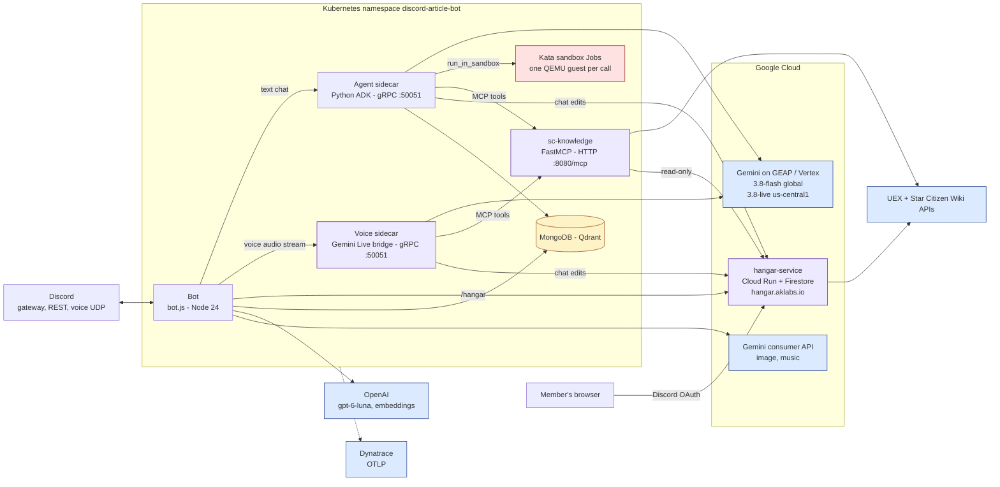
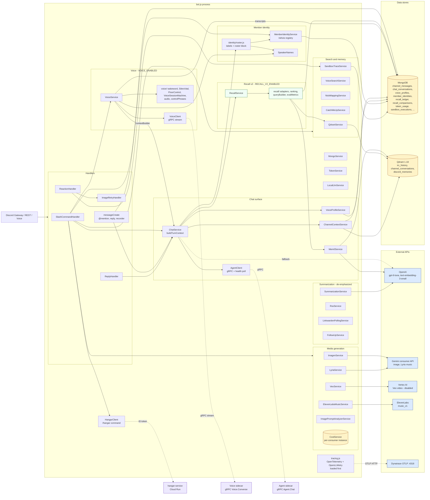
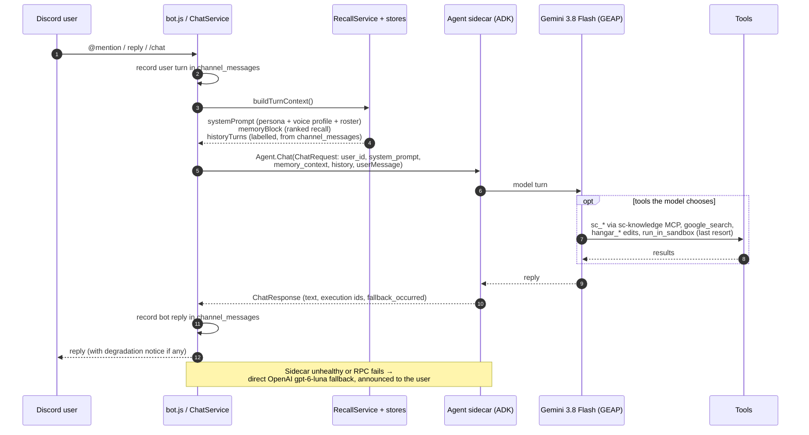
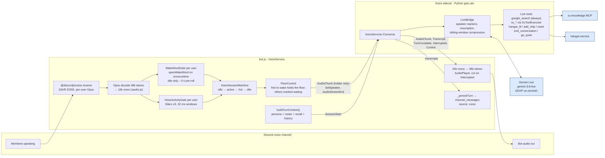
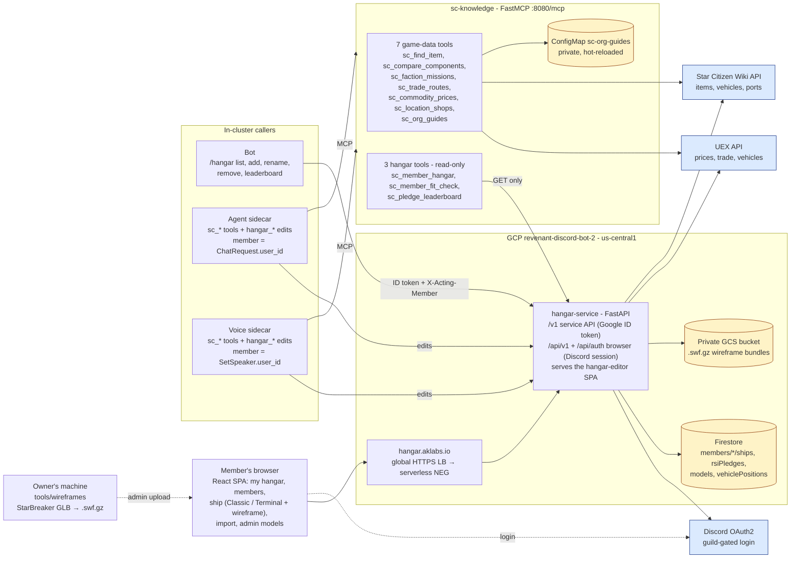

# Architecture

This document is the canonical overview of how Revenant (the Discord bot still deployed as `discord-article-bot`) is structured. It covers the runtime software architecture — the Node.js bot, its three Python services (agent sidecar, voice sidecar, sc-knowledge), the Star Citizen member hangar on Cloud Run — and the deployment topology (pods, NetworkPolicy, secrets, the Kata sandbox runtime).

The diagrams are Mermaid; they render on GitHub, in most Markdown viewers, and in VS Code with a Mermaid preview extension. [`chat-flow-memory.svg`](chat-flow-memory.svg) is the hand-drawn companion figure for the text chat turn.

Where to go deeper (each file is the source of truth for its area; this page only summarises):

| Area | Detail lives in |
|---|---|
| Per-feature behaviour | [features.md](../features.md) |
| Deploy commands, runbook | [kubernetes.md](../kubernetes.md), [k8s/sandbox/README.md](../k8s/sandbox/README.md), [k8s/voice/README.md](../k8s/voice/README.md) |
| Voice, bot side | [docs/voice.md](voice.md) |
| Voice, sidecar side | [voice-sidecar/CLAUDE.md](../voice-sidecar/CLAUDE.md) |
| Agent sidecar internals | [agent-sidecar/CLAUDE.md](../agent-sidecar/CLAUDE.md) |
| Star Citizen knowledge server | [sc-knowledge/CLAUDE.md](../sc-knowledge/CLAUDE.md) |
| Member hangar | [docs/hangar.md](hangar.md), [hangar-service/CLAUDE.md](../hangar-service/CLAUDE.md), [hangar-editor/CLAUDE.md](../hangar-editor/CLAUDE.md), [tools/wireframes/CLAUDE.md](../tools/wireframes/CLAUDE.md) |

---

## System at a glance

Five things run Revenant: one Node.js bot process that owns Discord, two gRPC sidecars that own the Gemini conversations (text agent and real-time voice), an MCP server for live Star Citizen data, and the member-hangar service on Cloud Run. Everything except the hangar lives in the `discord-article-bot` Kubernetes namespace.

---

## Software architecture — the bot process

The bot is a single Node.js process (`bot.js`) that wires 33 top-level services (plus 12 helper modules under `services/recall/`, `services/voice/` and `services/identity/`), 26 slash commands and 4 event handlers. Optional features — Mem0, Qdrant, channel context, voice profile, the agent sidecar, voice, the hangar client, each media-gen provider — are guarded behind config flags and skipped cleanly when disabled. Bot-owned state lives in MongoDB and Qdrant.

### Bot-process notes

- **`tracing.js` is required at the top of `bot.js`, before all other modules.** It wires `@opentelemetry/sdk-node` + auto-instrumentations + `@traceloop/instrumentation-openai`, so every OpenAI call carries full prompt/completion content as span attributes. The bot exports traces over OTLP HTTP (:4318); the three Python services export over OTLP gRPC (:4317).
- **`channel-voice` is the only personality.** Every chat entry point (`@mention`, reply-to-bot, `/chat`) ends in `ChatService.chat()`.
- **`channel_messages` is the single history source**, bot-inclusive. Every chat entry point — and every voice turn (`source: 'voice'`) — records both sides of its exchange there, so a later turn on either surface sees it.
- **Recall v2 is on in production** (`RECALL_V2_ENABLED=true`, shadow logging also on). `RecallService` over-retrieves from Mem0 (personal, explicit, shared), Qdrant channel semantic hits and channel facts; dedupes against the recent buffer; enriches from `recall_ledger`; ranks by a 14-day-half-life recency decay plus importance and access count; and injects one `## Memory Context` block. The recent-conversation buffer and voice-profile few-shot are assembled separately and are not ranked. Offline eval: `scripts/eval-recall.js`.
- **Member identity.** `MemberIdentityService` holds the `/whois` registry (Mongo `member_identities`, fully cached in memory). `buildTurnContext` labels every non-bot history turn `[Name · discordId]` and appends a `## People in this conversation` roster to the system prompt, so "I/me/my" resolve to the right speaker. `SpeakerNames` is the shared name resolver (registry → stored name → `VOICE_SPEAKER_NAMES` → Discord names).
- **Mem0 v3 stores everything in Qdrant** (`discord_memories` plus the `_entities` companion collection); its local history store is disabled. It no longer uses Postgres — see the deployment notes.
- **What gets written after a turn.** Every path records both sides in `channel_messages` and feeds `ChannelContextService` (hot buffer → Qdrant `channel_conversations` batch index every 5 min, plus periodic Mem0 *shared* channel-fact extraction). Personal Mem0 memories, `chat_conversations` and `token_usage` are written **only on the direct-OpenAI fallback path** — the agent path (nearly all production chat) writes none of them.
- **Each media-gen service owns its own `CostService` instance.** `/stats` reads `token_usage` and does not yet show media-gen rows (Approach B below).
- **Slash commands take services as constructor args**, so `scripts/registerCommands.js` can build the schema with `null` services. Registration replaces the whole command set: running it without `HANGAR_API_URL` drops `/hangar`.
- **`SandboxTraceService`** reads what the agent sidecar writes to `sandbox_executions`; `ReactionHandler` serves 🔍 / 📜 / 🐛 reveals from it. (The trace store has been silent since 2026-07-02 — a known defect.)

---

## Text chat turn

- **One context builder for both surfaces.** `ChatService.buildTurnContext()` returns `{ systemPrompt, memoryBlock, historyTurns }`; the text path sends it in `ChatRequest`, the voice path in `SessionStart`. The agent path forwards it untrimmed (Gemini's window is large); the direct-OpenAI fallback keeps the legacy `promptMaxTokens` trim.
- **Replies name their target.** A reply to a bot message prefixes the current turn with `[Replying to your earlier message: "…"]` so the model can't attach the reply to a newer, unrelated question.
- **Degradation is announced, never silent:** an agent RPC failure (OpenAI substitute named), a sidecar turn that ran on the generic `base.txt` (`fallback_occurred`), and a `buildTurnContext` failure each surface a notice.
- **Agent sidecar tools.** `run_in_sandbox` (gated as a last resort by `TOOL_AVAILABILITY_PREAMBLE`), ADK's plain `google_search`, the sc-knowledge MCP toolset (attached per turn only while a probe says it is healthy), and the three hangar edit tools. Health is a consecutive-failure breaker over real `Chat` outcomes — details in [agent-sidecar/CLAUDE.md](../agent-sidecar/CLAUDE.md).
- **Sandbox.** Each `run_in_sandbox` call spawns a Kubernetes Job whose pod is a QEMU/KVM guest (`runtimeClassName: kata-qemu-runtime-rs`), 2 vCPU / 2 GiB / 300 s, public-internet-only egress. Calls whose code targets Star Citizen data hosts are refused before a pod is spawned (`exit_code -4`, `use_sc_tools`).

---

## Voice

When `VOICE_ENABLED=true`, `/voice join` puts the bot in a Discord voice channel. The bot does the Discord-side audio work (receive, decode, wake word, VAD, floor control, playback); the **voice sidecar** (`discord-article-bot-voice`) holds one Gemini Live session per active channel over a bidirectional gRPC stream.

### Voice notes

- **gRPC contract** (`proto/voice.proto`, service `discordbot.voice.Voice`, port 50051): `Converse(stream VoiceClientEvent) returns (stream VoiceServerEvent)` plus `Health`. Client events: `SessionStart` (user, channel, guild, `system_prompt`, `recall_context`, voice name, history `Turn`s), `AudioChunk`, `AudioStreamEnd`, `SetSpeaker`, `AcknowledgeWaiting`, `SessionEnd`. Server events: `AudioChunk`, input/output `Transcript`, `TurnComplete`, `Interrupted`, `ErrorEvent`, `Control` (`end` / `quiet`).
- **Session modes.** `/voice join` is wake-word gated ("hey jarvis" by default); `/voice listen` (admins only) keeps the session hot without a wake word; `/voice leave` tears down; `/voice resume` ends quiet mode early. After each reply the session stays `hot` for a follow-up window (60 s deployed) before returning to `idle`.
- **Turn ending.** Client endpointing is on in production (`VOICE_CLIENT_ENDPOINTING=true`): Silero's speech-end, or an 800 ms silence backstop, sends `AudioStreamEnd`; otherwise Gemini's server-side VAD ends the turn. Barge-in is enabled (`VOICE_ALLOW_BARGE_IN=true`).
- **Who is speaking.** The bot sends `SetSpeaker` when the floor holder changes; the sidecar injects `[SPEAKER: name]` before that speaker's audio and re-announces it every turn (3.8-live follows prompts literally). Names come from `SpeakerNames` (registry first).
- **Context.** The session opens with the same `buildTurnContext()` the text path uses (15 s timeout, static persona fallback), plus voice-only persona notes (wake name, write-for-the-ear, digit reading, marker rules). The sidecar seeds history and recall as non-final turns and appends the SC, mechanics-dispute, control and hangar notes to the `system_instruction`.
- **Tools run in the sidecar.** Google Search is always attached. sc-knowledge declarations load once at startup (restart the sidecar after adding an `sc_*` tool); each call opens a fresh MCP session with a 6 s bound, and a failed SC attach retries search-only. Hangar edits act on `SetSpeaker.user_id` (else the session opener) — never a model-supplied ID. The bot only acts on `Control`, and only after the spoken confirmation has played.
- **Limits and recovery.** `VOICE_MAX_SESSION_SECONDS` (600) is a hard cap on every session. The sidecar resumes Live sessions across GoAway/disconnects (up to 5 reconnects) but never replays stale audio. On the bot side, `_resetToIdle` is the single recovery path. Phase 4 turn deferral is built but off (`VOICE_DEFERRAL_ENABLED=false`).
- **Transcripts and telemetry.** Each completed turn (user and bot) is written to `channel_messages` with `source: 'voice'`, so text chat sees voice conversations. The sidecar emits one `voice.session` span per conversation (turns, interruptions, reconnects, tool calls, search queries, hangar edits).

---

## Star Citizen knowledge and the member hangar

Two services give chat and voice live Star Citizen data: **sc-knowledge** (in-cluster, stateless, game data) and **hangar-service** (Cloud Run, per-member ships and loadouts, plus a web editor).

### sc-knowledge notes

- **Stateless FastMCP server** (`python:3.14-slim`, streamable HTTP at `:8080/mcp`, `GET /healthz` that never touches upstream). Its NetworkPolicy accepts ingress only from the agent and voice sidecars. A `421 Invalid Host header` is its own `SC_ALLOWED_HOSTS` allow-list, not the NetworkPolicy.
- **Sources:** UEX (`api.uexcorp.uk/2.0`) and the Star Citizen Wiki API, plus the org's private guides (PDF → text → ConfigMap via `scripts/sync-org-guides.sh`; never committed, never in an image). Expired cache entries are served `stale: true` rather than failing.
- **Isolation:** the agent sidecar attaches the toolset per turn only while a cached probe (`/healthz` *and* a real tool listing) passes; when sc-knowledge is down the turn still runs with an "SC tools unavailable" note. The toolset is wrapped in a non-closing proxy so per-turn ADK runners can't close it. MCP timeouts are 3 s connect / 15 s read.
- **Sandbox avoidance** has three layers: tool results as the intended path, a host-pattern refusal in `run_in_sandbox`, and an eval gate (`eval/eval_sc.py`).

### Member hangar notes

- **Cloud Run, not the cluster.** `hangar-service` runs in GCP project `revenant-discord-bot-2`, `us-central1`, min-instances 1, image tagged with the git short SHA, Firestore Native as its datastore. The same container serves the API and the built `hangar-editor` SPA (React 18 + Vite + TypeScript, three.js for wireframes) at `https://hangar.aklabs.io` through a global HTTPS load balancer.
- **Two authentication modes, one service.**
  - *Service callers* (bot, sc-knowledge, agent sidecar, voice sidecar) present a Google ID token minted from the `hangar-api@` service-account key (Secret `hangar-api-sa`, mounted at `/var/secrets/hangar/key.json`). The audience is exactly `https://hangar-service-hvmf2jpuca-uc.a.run.app`. The acting member travels in `X-Acting-Member`, set by trusted plumbing — never a model tool argument.
  - *Browsers* log in with Discord OAuth2 (gated to the main guild at login) and get a signed `__Host-hangar_session` cookie; writes also need a matching Origin (CSRF).
  - Writes require acting member = path member, or an admin ID. Reads of any member are allowed. Cloud Run's invoker IAM check is **off on purpose** — the app's auth is the only gate.
- **Data model.** A ship stores only the slots changed from stock (`fitted`); stock loadouts come from the Wiki vehicle `ports[]` catalog, with UEX for prices and items the Wiki misses (catalog cached 12 h, stale-while-revalidate).
- **Imports.** spviewer loadout import (replaces the fitted map), and RSI pledge import via HangarXPLOR (HTF), which also writes the `rsiPledges` ledger behind the pledge leaderboard. Pledge costs are visible to every signed-in member by the owner's choice.
- **Wireframes.** Ship wireframes with real hardpoint positions come from a local-only pipeline (`tools/wireframes/`: StarBreaker GLB → welded, culled, quantised `.swf.gz`). Bundles are uploaded by an admin, stored in a private GCS bucket, and served only to signed-in members. **Extracted game data never enters this repo or any image** (both Docker contexts ignore `**/*.glb` and `**/*.swf.gz`).
- **Ship data is tool-called, never injected into prompts.** sc-knowledge's hangar client is read-only; edits go through the sidecars' `hangar_fit` / `hangar_add_ship` / `hangar_reset`, and a `maybe_applied` result is never retried blindly.

---

## Deployment architecture

Everything except the hangar lives in the `discord-article-bot` namespace on the Harvester / RKE2 cluster. At steady state the namespace runs the bot, two sidecars, sc-knowledge, ephemeral Kata sandbox Jobs, and the stateful infra (MongoDB, Qdrant, plus a now-unused Postgres).

```mermaid
flowchart TB
    Internet[Internet<br/>Discord, OpenAI, Google APIs,<br/>UEX, Star Citizen Wiki]
    Ollama2[Ollama @ 192.168.1.164<br/>home network - disabled]

    subgraph GCPP[GCP revenant-discord-bot-2]
        CR[Cloud Run: hangar-service<br/>+ Firestore, GCS, LB]
        GEAPD[Vertex / GEAP<br/>Gemini 3.8 Flash + 3.8 Live]
    end

    subgraph Cluster[Kubernetes cluster - Harvester / RKE2]
        subgraph DTNS[dynatrace namespace]
            DTIngest[telemetry-ingest<br/>OTLP :4317 / :4318]
        end

        subgraph LWNS[linkwarden namespace]
            LW[Linkwarden :3000<br/>disabled]
        end

        subgraph NS[namespace: discord-article-bot]
            direction TB

            subgraph BotPod[discord-article-bot - 1 replica - Recreate]
                Bot[mvilliger/discord-article-bot:semver<br/>SA discord-article-bot<br/>Service :8080 health]
            end

            subgraph AgentPod[discord-article-bot-agent - 1 replica - Recreate]
                Agent[mvilliger/discord-article-bot-agent:sha<br/>SA agent-sa + Role agent-sandbox-orchestrator<br/>Service :50051 gRPC]
            end

            subgraph VoicePod[discord-article-bot-voice - RollingUpdate]
                VoiceP[mvilliger/discord-article-bot-voice:sha<br/>SA agent-sa, no K8s API use<br/>Service :50051 gRPC]
            end

            subgraph SCKPod[sc-knowledge - RollingUpdate]
                SCKP[mvilliger/sc-knowledge:sha<br/>default SA, no token<br/>Service :8080 MCP]
            end

            subgraph SBPods[Ephemeral sandbox Jobs - per call]
                Sandbox[mvilliger/sandbox-base:sha - lockstep with agent<br/>runtimeClassName: kata-qemu-runtime-rs<br/>2 vCPU / 2 Gi / 300 s - SA sandbox-sa, no token]
            end

            subgraph Infra[Stateful infra]
                Mongo2[(mongodb :27017<br/>mongo:6.0 - repo-root mongo.yml)]
                Qdrant2[(qdrant :6333 / :6334<br/>qdrant/qdrant:v1.18.3 - Recreate)]
                PG2[(postgres-mem0 :5432<br/>pgvector:pg16 - unused)]
            end

            CM[ConfigMaps<br/>discord-article-bot-config,<br/>sandbox-config, discord-article-bot-prompt,<br/>sc-org-guides]
            Sec[Secrets<br/>discord-article-bot-secrets,<br/>google-cloud-service-account,<br/>agent-genai-sa, hangar-api-sa,<br/>sc-knowledge-secrets]
            NP[NetworkPolicies<br/>discord-article-bot, agent-egress,<br/>voice-egress, sc-knowledge,<br/>sandbox-egress]
        end
    end

    Bot -.gRPC :50051.-> Agent
    Bot -.gRPC :50051.-> VoiceP
    Agent -.MCP :8080.-> SCKP
    VoiceP -.MCP :8080.-> SCKP
    Agent -.K8s API.-> SBPods
    SBPods -.public internet only.-> Internet
    Bot --> Mongo2
    Bot --> Qdrant2
    Agent --> Mongo2
    Agent --> Qdrant2

    Bot -->|OTLP HTTP| DTIngest
    Agent -->|OTLP gRPC| DTIngest
    VoiceP -->|OTLP gRPC| DTIngest
    SCKP -->|OTLP gRPC| DTIngest
    Bot -.-> LW
    Bot -.-> Ollama2
    Bot -->|gateway, REST, voice UDP| Internet
    Agent --> GEAPD
    VoiceP --> GEAPD
    NS ==>|"443 - Google ID token<br/>bot, agent, voice, sc-knowledge"| CR
    SCKP --> Internet

    classDef pod fill:#dcfce7,stroke:#166534
    class Bot,Agent,VoiceP,SCKP,Sandbox pod
    classDef store fill:#fef3c7,stroke:#92400e
    class Mongo2,Qdrant2,PG2 store
    classDef policy fill:#fee2e2,stroke:#991b1b
    class NP policy
    classDef cfg fill:#e0e7ff,stroke:#3730a3
    class CM,Sec cfg
    classDef cloud fill:#dbeafe,stroke:#1e3a8a
    class CR,GEAPD cloud
```

### Deployment notes

- **`k8s/overlays/deployed/` is the source of truth and is gitignored** (it holds real secrets). Tracked manifests in `k8s/sandbox/`, `k8s/voice/` and `k8s/sc-knowledge/` carry placeholders (e.g. `REPLACE_WITH_SHA`) — never apply them directly. Do not use kustomize; `k8s/base/` and `k8s/overlays/prod/` are out of sync. Infra manifests: `k8s/mem0/qdrant.yaml`, `k8s/mem0/postgres.yaml`, and `mongo.yml` at the repo root.
- **Image tags.** The bot image is tagged with its npm semver (`2.25.0`); every other image is tagged with a git short SHA, never `:latest`. The agent sidecar and `sandbox-base` move in lockstep (the agent's `SANDBOX_BASE_IMAGE` env and its own image are bumped together). hangar-service images go to Artifact Registry in `revenant-discord-bot-2`.
- **Strategies.** The bot and the agent sidecar are single-replica `Recreate` (in-process state: the bot's Discord session, the agent's sandbox concurrency budget) — do not scale either. The voice sidecar is `RollingUpdate` so a rollout doesn't drop live calls. sc-knowledge is stateless, `RollingUpdate`.
- **Gemini runs on GEAP (Vertex).** Both sidecars authenticate with the `agent-genai-sa` key. The agent uses location `global`; the voice sidecar must use `us-central1` (the only location serving `gemini-3.8-live` on this project). The bot's image and music generation still use the consumer `GEMINI_API_KEY`.
- **Hangar credentials.** All four callers (bot, agent, voice, sc-knowledge) mount Secret `hangar-api-sa`, readable by uid 1000. Key rotation needs pod restarts.
- **Sandbox isolation is Kata, not gVisor** (switched 2026-04-29: Harvester's immutable SLE Micro host makes `runsc` impractical). Cold start adds ~1.5–3 s per call. Sandbox pods carry `dynatrace.com/inject: "false"`; without it OneAgent held PID 1 and executions took ~120 s.
- **NetworkPolicy posture** (default-deny; RFC1918 excluded from every "public" rule):
  - **Bot:** DNS, MongoDB :27017, Qdrant :6333/:6334, agent :50051, voice :50051, Dynatrace :4317/:4318, Linkwarden :3000, Ollama `192.168.1.164:11434`, and public internet on all TCP/UDP ports (Discord voice uses UDP).
  - **Agent sidecar:** DNS, MongoDB, Qdrant, sc-knowledge :8080, the K8s API (`10.53.0.1` and the control-plane IPs on 443/6443), Dynatrace, public :443. Ingress only from the bot on :50051.
  - **Voice sidecar:** DNS, sc-knowledge :8080, Dynatrace, public :443 (GEAP, hangar). Ingress only from the bot on :50051.
  - **sc-knowledge:** DNS, Dynatrace :4317, public :443 (UEX, Wiki, hangar). Ingress only from the agent and voice sidecars on :8080.
  - **Sandbox pods:** DNS plus the public internet only — every private range is denied, including the pod CIDR (`10.52/16`), service CIDR (`10.53/16`), link-local, CGNAT, the host network and the K8s API.
- **Disabled but still wired:** Linkwarden (`LINKWARDEN_ENABLED=false`), Ollama (`LOCAL_LLM_ENABLED=false`) and Veo (`VEO_ENABLED=false`) keep their config, secrets and egress rules.
- **`postgres-mem0` is unused.** Mem0 v3 stores vectors in Qdrant and runs with its history store disabled; nothing in the code connects to Postgres. The pod and its 5 Gi PVC remain deployed.

---

## When you toggle features

| Flag | Disabling means |
|---|---|
| `AGENT_ENABLED=false` | Channel-voice chats route directly to OpenAI; no sandbox, no SC tools, no chat hangar edits in text. The sidecar pod isn't needed. |
| `VOICE_ENABLED=false` | `/voice` is not wired and the voice classes and native models are never loaded. The voice sidecar isn't needed. |
| `SC_KNOWLEDGE_ENABLED=false` (per sidecar) | That sidecar answers without `sc_*` tools (and the agent sidecar without hangar edits); each sidecar's flag is independent. |
| `HANGAR_API_URL` unset | `/hangar` is not registered and sidecar hangar edits are not attached. Re-running `registerCommands.js` without it drops `/hangar`. |
| `HANGAR_EDITS_ENABLED=false` (per sidecar) | Members can read hangars by voice/chat but not edit them. |
| `VOICE_CONTROL_COMMANDS_ENABLED` / `VOICE_CONTROL_TOOLS_ENABLED=false` | Spoken "that's all" / "go quiet" are ignored (bot-side phrase backstop / sidecar tools respectively). |
| `MEM0_ENABLED=false` | No long-term personal memory; the bot still chats. |
| `QDRANT_IRC_ENABLED=false` | `/recall`, `/history`, `/throwback`, voice-informed search and voice-profile sampling go offline. |
| `CHANNEL_CONTEXT_ENABLED=false` | No passive channel awareness or channel semantic recall. |
| `RECALL_V2_ENABLED=false` | ChatService falls back to the legacy scattered recall path (`RecallService` and `recall_ledger` go dormant). Production runs with v2 on and shadow logging (`RECALL_SHADOW_ENABLED`) on. |
| `IMAGEGEN_ENABLED`, `VEO_ENABLED`, `MUSICGEN_ENABLED`, `ELEVENMUSIC_ENABLED` | Each unhooks one slash command and one service. |
| `LINKWARDEN_ENABLED`, `RSS_FEEDS_ENABLED`, `LOCAL_LLM_ENABLED` | Article-archive polling, feed posting, Ollama fallback. All three are off in production today. |

---

## Open architectural follow-ups

- **Approach B — `MediaGenBase` refactor.** `ImagenService`, `VeoService`, `LyriaService` and `ElevenLabsMusicService` duplicate plumbing (enabled checks, error shaping, attachments, per-call cost). Lift it into a base class and hoist a single `CostService` into `bot.js`, so cost figures are unified.
- **MongoDB-backed media-gen records for `/stats`.** `/stats` reads `token_usage` only; flat-fee media-gen calls don't appear.
- **Personal Mem0 writes on the agent path.** Agent-path turns don't call `_storeMemories`, so per-user long-term memory only grows from explicit `/remember` and the rare fallback turn. Decide whether the agent path should write it (memory is a core feature).
- **Sandbox trace store is silent** (no `sandbox_executions` rows since 2026-07-02), so the 🔍 / 📜 / 🐛 reaction reveal is likely broken.
- **Retire `postgres-mem0`.** Unused since Mem0 v3; snapshot and remove the Deployment and PVC, or document why it stays.
- **Voice-profile regen-pipeline hardening.** `scripts/prompt-tuning/` (see its [README](../scripts/prompt-tuning/README.md)) iterates on the `personalities/channel-voice.js` template offline; synthesis-prompt tightening, a topic-bleed filter and eval-gated rotation are still outstanding.
- **Qdrant index startup catch-up.** In-memory buffer rehydration from MongoDB ships, but up to `CHANNEL_CONTEXT_BATCH_INTERVAL` minutes of messages can miss the Qdrant semantic index after an unclean shutdown. A startup catch-up from `channel_messages` would close it.
- **MediaGen integration checklist.** A new secret-backed service needs both the `secret.yaml` key and the `deployment.yaml` `secretKeyRef` binding; PR #79 missed the second.
